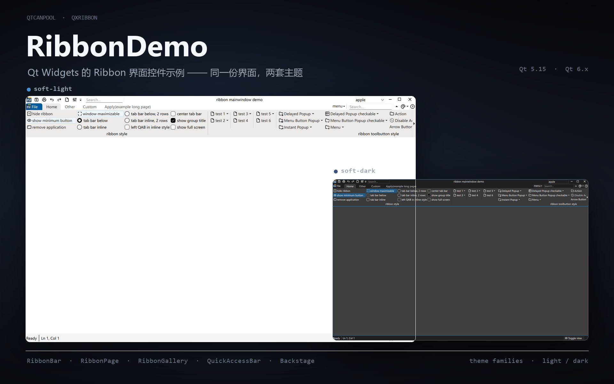

# qtcanpool

<div align="center">

[](https://github.com/canpool/qtcanpool/actions/workflows/ci.yml)
[](https://canpool.github.io/qtcanpool/)
[](https://canpool.github.io/qtcanpool/demo/)
[](./LICENSE)
[](https://www.qt.io/)
[](https://isocpp.org/)

</div>

一套总结自 Qt Creator 源码结构的通用项目管理模板，核心库基于 QtWidgets 构建，集成了 Ribbon、可停靠窗口（Dock）、自定义窗口（Window）等常用界面组件，并自带插件体系（qxplugin）。

qtcanpool 旨在提供优秀的项目管理方式、多样的选择与优质的控件。

## 界面预览

同一份 RibbonDemo 界面，在 `soft-light` 与 `soft-dark` 两套主题下（其它主题族见 [`res/themes/`](./res/themes)）：



## 主要组件

| 组件 | 命名空间 | 说明 |
| :--- | :------- | :--- |
| **qxcore** | `QxCore` | 基础设施库：配置（`QxSettings`）、日志（`QxLogger`）、语言切换（`QxTranslator`），仅依赖 Qt Core |
| **qxtheme** | `QxTheme` | 主题引擎：调色板 + 样式表统一应用（预置主题族见 [`res/themes/`](./res/themes)，每族明暗各一套）、运行时切换、选择持久化、可跟随系统深浅色 |
| **qxribbon** | `QxRibbon` | Ribbon 风格界面组件（菜单栏 / 页 / 分组等） |
| **qxdock** | `QxDock` | 可停靠窗口组件（布局管理、浮动容器等） |
| **qxwindow** | `QxWindow` | 自定义窗口组件（无边框窗口、系统按钮代理等） |
| **qxplugin** | `QxPlugin` | 插件体系：插件契约（`QxPlugin`）、宿主上下文（`QxPluginContext`）、加载与依赖解析（`QxPluginManager`）、对象池（`QxObjectPool`） |
| **qxapp** | `QxApp` | 应用框架库：`RibbonAppWindow`（无边框 Ribbon 窗口）与 `QxAppShell` 应用外壳（导航轨 + 页面栈 + 停靠区 + 状态栏 + 启动屏 + 布局持久化）、应用内通知（`QxToast`）、设置界面（`QxPropertyEditor` / `QxSettingsDialog`） |
| **qtcompat** | — | Qt 5 / Qt 6 跨版本兼容辅助头（header-only） |

> **qcanpool 已于 3.2 删除。** 它在 3.1 已被清空（legacy Ribbon 物理移除、11 个遗留控件下线、
> 7 个通用控件迁入 `qxapp` 并改名），只剩 7 个带弃用告警的转发头；3.2 连这个库一起消失，
> **旧名不再存在**。迁移见 [`doc/design/3.0-MIGRATION.md`](./doc/design/3.0-MIGRATION.md)。

## 仓库

- GitHub：[https://github.com/canpool/qtcanpool](https://github.com/canpool/qtcanpool)
- Gitee：[https://gitee.com/icanpool/qtcanpool](https://gitee.com/icanpool/qtcanpool)

## 文档

- **在线文档**：[https://canpool.github.io/qtcanpool/](https://canpool.github.io/qtcanpool/) —— C++ API 参考（Doxygen）+ 使用指南，由 GitHub Actions 从 `master` 自动发布
- **本地构建文档站点**：只需要 Doxygen（和可选的 Graphviz），**不需要 Qt**，因为文档直接读头文件而非编译

```bash
cmake -S doc -B build-docs
cmake --build build-docs --target docs   # 产物在 build-docs/html/index.html
```

- 指南源码在 [`doc/pages`](./doc/pages)（构建、架构、CI、组件、主题、AppShell、插件、迁移、贡献、发布、Doxygen、已知限制、版本对照），与 API 一同发布

## 在线体验

`AppShellDemo` 已编译为 WebAssembly，可直接在浏览器中打开，无需安装 Qt 或编译器：

- **在线 demo**：[https://canpool.github.io/qtcanpool/demo/](https://canpool.github.io/qtcanpool/demo/) —— 一个完整的应用外壳：侧边导航、页面切换、可停靠面板、主题切换与布局持久化

## 教程

- [使用教程](https://blog.csdn.net/canpool/category_10631139.html)
- [官方文档](https://blog.csdn.net/canpool/article/details/114523758)

## 目录结构

| 一级目录 | 二级目录 | 说明 |
| :------- | :------- | :--- |
| `cmake` | | CMake 构建框架 |
| `demos` | | 综合示例程序 |
| `doc` | | 文档：Doxygen 站点源码（`Doxyfile.in`、`pages/` 指南、`qtcanpool-doxygen.css`）与设计文档 |
| `examples` | | 控件级示例（`WITH_EXAMPLES`，默认随构建编译） |
| `projects` | | 项目示例：`template` 最小应用模板、`consume` SDK 消费验证、`plugin` 外部插件验收 |
| `scripts` | | 辅助脚本：`new-project` 生成新工程骨架、`push` 推送双远程 |
| `src` | `libs` | 基础类库 |
| | `modules` | 插件样板模块：`output` / `notebook` / `filetree`（K16 样板定位） |
| | `plugins` | 框架自身功能插件（预留，当前只有分层骨架） |
| | `shared` | 共享的实用代码 |
| `tests` | | 单元测试（CTest） |

## 环境要求

**自 3.0 起的基线：**

- Qt **5.15** 及以上（主推 Qt 6.8 / 6.12 LTS）
- C++17
- CMake 3.16+（推荐最新版本）

**已验证环境**（本地与 CI 构建矩阵，随 CI 演进）：

- Qt 6.12.0 / 6.8.1 / 5.15.2（MinGW / MSVC，64bit）；**最低支持 Qt 5.15**（决策 K1，4.3 起 5.14 及更早的兼容分支已删除）
- 其它环境未测试，推荐使用 [Qt LTS](https://download.qt.io/official_releases/qt/) 版本

## 构建

**CMake 是唯一构建方式**（qmake 已于 4.0 移除，全树不再有 `.pro` / `.pri`）。

```bash
# 配置（Qt 通过 CMAKE_PREFIX_PATH 指定）
cmake -S . -B build -DCMAKE_PREFIX_PATH=<Qt安装目录>/<版本>/<编译器> -DCMAKE_BUILD_TYPE=Release

# 编译
cmake --build build --config Release --parallel

# 运行单元测试
ctest --test-dir build -C Release --output-on-failure
```

说明：

- 各功能开关（`WITH_DEMOS`、`WITH_TESTS`、`WITH_DOCS` 等）可通过 `cmake -S . -B build -LH` 查看
- `-DWITH_DOCS=ON` 会把文档站点目标 `docs` 一并加入主构建（只需 Doxygen）；只想要文档时用上面的 `cmake -S doc -B build-docs`
- 亦可使用 Qt Creator 直接打开根目录 `CMakeLists.txt`
- 编译出的 demo 位于构建目录的 `bin/`（Windows）或 `libexec/qtproject/`（其它平台），例如 `RibbonDemo`、`DockDemo`、`AppShellDemo`（应用外壳：导航 + 页面 + 停靠 + 主题 + 布局持久化）、`QxWindowDemo`（无边框窗口：自绘标题栏 + 窗口材质）、`IdeShellDemo`（插件化外壳：宿主不认识任何模块）；其中 `IdeShellDemo` 显式指定了输出目录，各平台都在 `bin/`

安装与下游消费：

```bash
# 公开头文件与 CMake 包配置位于 Devel 组件，需显式安装
cmake --install build --config Release --prefix <安装目录>
cmake --install build --config Release --prefix <安装目录> --component Devel
```

下游工程 `find_package(QtCanpool)` 后可直接链接 `QtCanpool::qxcore` / `QtCanpool::qxribbon` / `QtCanpool::qxapp` 等目标；
仓库内 `projects/consume` 是最小下游示例，打包骨架见 `ports/qtcanpool/`（vcpkg）与根目录 `conanfile.py`（Conan）（未经 CI 验证）。

## 路线图

- 总路线、决策索引与库版本规则见 [ROADMAP-3.x](./doc/ROADMAP-3.x.md)。
- 每个开发版本的任务清单位于 [`doc/design/`](./doc/design/)，按 `<版本>-TASKS.md`（如 `4.5-TASKS.md`）命名，随版本推进新增，不构成此处固定列表。
- 2.x → 3.0 迁移指南见 [3.0-MIGRATION](./doc/design/3.0-MIGRATION.md)。

## 版本

- 格式：`x.y.z`（主版本.次版本.补丁版本）

## 分支

| 分支 | 说明 |
| :--- | :--- |
| [master](https://gitee.com/icanpool/qtcanpool/tree/master/) | 主线分支（4.0 起为开发主线） |
| [develop](https://gitee.com/icanpool/qtcanpool/tree/develop/) | 历史分支，开发已统一到 master |
| [release-3.x](https://gitee.com/icanpool/qtcanpool/tree/release-3.x/) | 3.x 维护分支（4.0 起不再新建 release-4.x；已冻结） |

- 版本发布以 tag 标记。**常态只维护最新的 4.x**（基于 `master`）；
  若某个已发布的 tag 出现必须修复的缺陷，则**按需**从该 tag 拉临时分支修复并打新 tag，
  修完即止、不作长期维护；到 5.0 发布时再拉 `release-4.x` 作为 4.x 的维护分支
  （决策见 [`doc/design/4.3-TASKS.md`](doc/design/4.3-TASKS.md) K33）

## 开发规范

- C++ 风格：[Google C++ Style Guide](http://google.github.io/styleguide/cppguide.html)、[Qt 编程风格与规范](https://blog.csdn.net/qq_35488967/article/details/70055490)
- 源文件编码：一律**不带 BOM 的 UTF-8**（含中文的同样不带 BOM；MSVC 侧由根 `CMakeLists.txt` 的 `/utf-8` 开关保证按 UTF-8 解码，细节见 [贡献指南](doc/pages/contributing.md)）
- **代码中的注释一律使用英文**（文档等 `.md` 文件不拘）
- 代码格式化：随仓库提供 [`.clang-format`](./.clang-format)（C++17），CI 中作为强制门禁
- Git 提交格式（**自 3.0 起**）：`type(scope): subject`，以区分早期提交格式
  - 提交信息一律使用**英文**（subject 与正文）
  - `type`：`feat` / `fix` / `docs` / `style` / `refactor` / `perf` / `test` / `build` / `ci` / `chore` / `revert`
  - `scope`：受影响范围，完整清单见 [贡献指南](doc/pages/contributing.md)，如 `qxcore` / `qxtheme` / `qxribbon` / `qxdock` / `qxwindow` / `qxapp` / `qxplugin` / `themes` / `modules` / `project` / `ci` / `test` / `docs`
  - 示例：`feat(qxribbon): add ribbon gallery group`、`fix(qxwindow): fix taskbar coverage on secondary screen`
  - 早期提交格式参考：[git 知：提交格式](https://blog.csdn.net/canpool/article/details/126005367)

## 贡献

- 欢迎提交 [issue](https://github.com/canpool/qtcanpool/issues) 对关心的问题发起讨论
- 欢迎 Fork 仓库并通过 pull request 贡献代码
- 贡献者可在文件头版权中添加个人信息，格式如下：

```cpp
/**
 * Copyright (C) YYYY NAME <EMAIL>
 * Copyright (C) 2023 maminjie <canpool@163.com>
 * SPDX-License-Identifier: MulanPSL-2.0
**/
```

## 示例

综合示例在 [`demos/`](./demos)（`WITH_DEMOS`，默认随构建编译），控件级示例在 [`examples/`](./examples)（`WITH_EXAMPLES`，默认随构建编译），构建与运行见上文「构建」一节。

- **RibbonDemo**（`demos/qxapp/ribbondemo`）—— Ribbon 风格界面示例：菜单栏 / 页 / 分组与主题切换。
- **DockDemo**（`demos/qxapp/dockdemo`）—— 可停靠窗口示例：多种停靠布局、自动隐藏、拖拽重组、XML 布局存取，以及深浅主题下自动着色的内置图标。
- **AppShellDemo**（`demos/qxapp/appshell`）—— 应用外壳示例（导航轨 + 页面栈 + 停靠区 + 状态栏 + 布局持久化），也是 WebAssembly 在线演示的载体（见「在线体验」）。
- **IdeShellDemo**（`demos/qxapp/ideshell`）—— 插件化外壳示例：宿主不认识任何模块。
- **QxWindowDemo**（`demos/qxwindow`）—— 无边框窗口示例：窗口代理 `setup` 装到窗口上，标题栏、菜单栏与四个系统按钮全部由示例自己搭，并演示整套窗口材质（Windows 的 DWM blur / acrylic / mica / mica alt，macOS 的毛玻璃）。

## 快速体验

下载源码，使用 Qt Creator 打开根目录 `CMakeLists.txt`，在目标中选择 `RibbonDemo`、`DockDemo`、`AppShellDemo`、`QxWindowDemo` 或 `IdeShellDemo` 运行即可体验（命令行构建见上文「构建」一节）。

## 赞助

如果您觉得本项目对您有帮助，欢迎赞助，助力项目更好地发展。


赞助名单：[名单](./doc/sponsor/sponsor.md)

## 交流

- QQ 群：831617934（Qt 业余交流）

## 许可

- 本项目遵循 [MulanPSL-2.0](./LICENSE) 开源许可协议
- 集成组件遵循[各自](./LICENSE.NOTES.md)的开源许可协议
